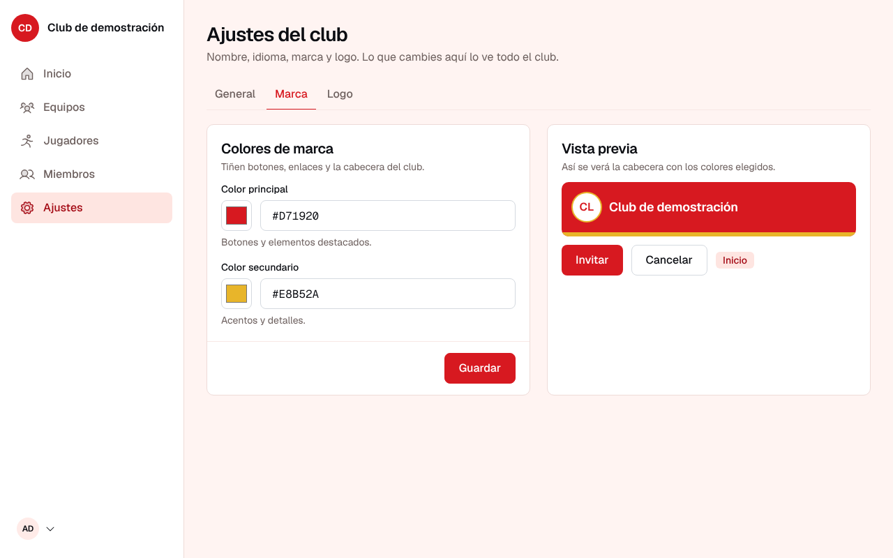
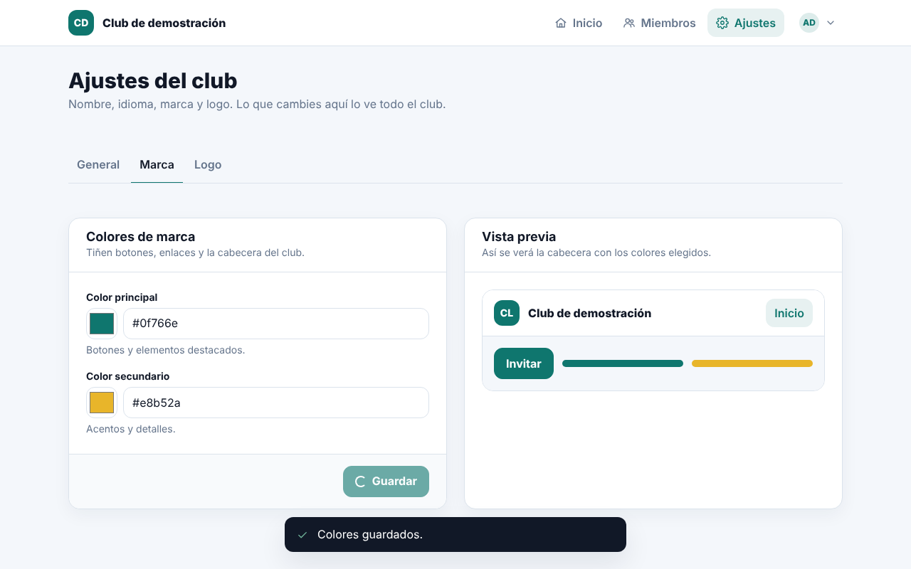
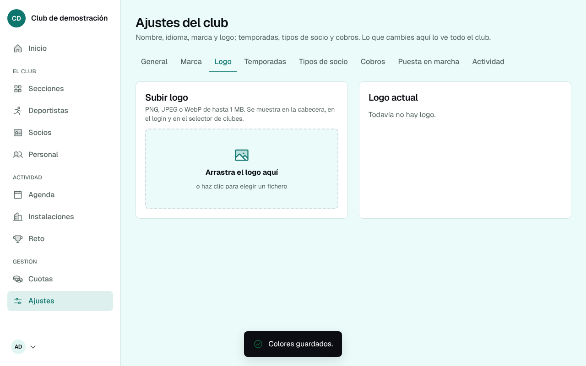
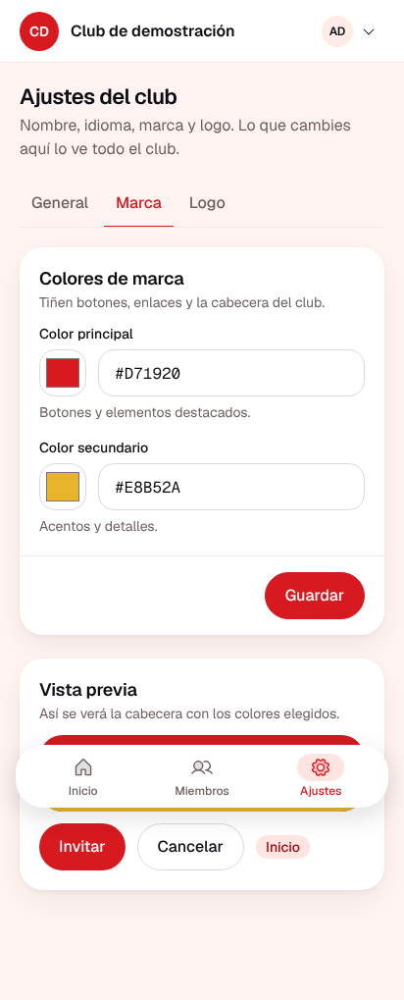

# Capturas de la interfaz (Bloques 14 a 26 y pizarra animada)

Capturas que generan las pruebas de interfaz (`pnpm test:ui`) contra la API real con base embebida, con el front de Vite + React + Tailwind sobre el design system del producto (`packages/design`, ADR 0027). Escritorio a 1280x800; móvil, Pixel 7. La fuente viva es el artefacto `capturas-interfaz` de CI; esta carpeta es la foto de la revisión del club completo (ADR 0031), con el design system 1.3: todo botón lleva el icono de su acción (rueda dentada para editar, cubo de basura rojo para eliminar, más para añadir); la fila es el objeto (se abre tocándola, con acciones como iconos silenciosos sin borde); la paleta de mandos ⌘K encuentra personas, equipos, pantallas y acciones; y la plantilla de un equipo se ve como un tablero por posición: secciones por deporte, socios, agenda e instalaciones, cuotas y "ver como", sobre lo que ya había de los bloques 11 a 13 (ADR 0028, 0029 y 0030), más el alcance por cargo y la gestión de acceso por rol del Bloque 19 (ADR 0033): el cuerpo técnico, la dirección y la fisio ven solo su parte del club, y "Personal" gana la pestaña "Acceso", y el partido en directo del Bloque 20 (ADR 0034): configuración del motor por sección, consola en la banda a pantalla completa y en tres zonas con el banquillo arrastrable (ADR 0037), estadísticas e histórico, y el entrenamiento de los bloques 21 a 26 (ADR 0039): semana del equipo con "A tener en cuenta", sesión por bloques con su cierre y modo pista, biblioteca con pizarra, carga, enfermería, salud y "Mi bienestar".

Cada club vive en una ruta del mismo dominio: el club demo en `/demo`, el negocio en `/admin`. Cuentas de demostración, todas con contraseña `123456`: `admin@demo.test` (administra el club demo; en este entorno también la plataforma), `entrenador@demo.test` (entrenadora del Alevín A), `familia@demo.test` (madre de dos jugadores y socia), `director@demo.test` (dirección deportiva), `fisio@demo.test` (fisioterapia), `senior@demo.test` (entrenador del Sénior A), `preparador@demo.test` (preparación física), `jugador@demo.test` (deportista adulto del Sénior A con cuenta propia), `natacion@demo.test` (coordinación de natación) y `basquet@demo.test`, `basquetfem@demo.test` y `yoga@demo.test` (cuerpo técnico). El club demo llega con la temporada 2026-27, cuatro secciones (fútbol sala, baloncesto, natación y yoga) con categorías, doce equipos y grupos, 95 deportistas, socios con tres tipos, cuatro instalaciones con horario, la agenda generada desde los horarios, partidos, planes de cuota con cargos y pagos, un reto activo, dos partidos jugados del Alevín A con su registro completo y el Sénior A con cuatro partidos, sesiones planificadas, cuatro semanas de carga y bienestar, biblioteca de tareas, un jugador limitado y otro en readaptación.

## Acceso

### Entrada general, con la marca del producto

### Login: error de credenciales

### Recuperar contraseña

### Recuperar contraseña: confirmación

### Nueva contraseña sin enlace válido

## El inicio del club completo (`/demo`)

### Portada del administrador: héroe con el próximo evento, hoy en el club, recuentos y el club por deporte

### Inicio con alertas del club, preparación de las fichas y actividad plegada

### Inicio completo: secciones, alertas y recuentos de socios y cuotas (Bloque 14)

### Menú de persona: ver el club como otra persona, clubes, negocio, idioma y salir

### Paleta de mandos (⌘K): "alev" encuentra el Alevín A; también personas, pantallas y acciones

## Ver el club como otra persona (Bloque 14)

### Elegir a quién mirar: personal, familias y administración del club

### El club con los ojos de la entrenadora, con la banda de salida

### El club con los ojos de una familia

## Secciones por deporte (`/demo/sections`, Bloque 14)

### Secciones: una tarjeta por deporte con sus cifras, coordinación y alertas

### Nueva sección: el deporte propone el nombre y las categorías (hoja)

### Ficha de sección: categorías con sus equipos, resumen, alertas y accesos

### Personal de la sección

### Nueva categoría (hoja)

### Nuevo equipo en una categoría (hoja)

### Ficha de equipo: plantilla, cuerpo técnico con cargo y horario semanal

### Horario semanal del equipo, del que se genera la agenda (hoja)

### Añadir a la plantilla a un jugador del club

## Deportistas y familias (`/demo/players`)

### Deportistas con sección, equipo, socio, familia y estado

### Ficha de deportista: foto, indicadores, objetivo, acciones prioritarias, timeline, datos personales y de socio, PDI, equipos, familia y estado

### Valorar los indicadores (hoja)

### Ficha con foto, indicadores revisados y un registro añadido al timeline

### Invitar a la familia desde la ficha

### Invitación de familia pendiente, con el enlace de pruebas

### Alta de un deportista

### Dar de baja: confirmación con el texto del design system

## Socios (`/demo/club-members`, Bloque 15)

### Socios con número, tipo, papeles en el club, cuotas y estado

### Nuevo socio: persona nueva o alguien que ya está en el club (hoja)

### Ficha de socio: persona, socio, papeles y cuotas

## Agenda e instalaciones (`/demo/agenda`, `/demo/facilities`, Bloque 16)

### Agenda de la semana, por sección, equipo o instalación

### Nuevo evento con instalación y repetición semanal (hoja)

### Detalle de un entrenamiento: equipo, instalación y pase de lista

### Instalaciones con apertura y uso de la semana

### Ficha de instalación: horas de apertura y ocupación semanal

## Cuotas y cobros (`/demo/fees`, Bloque 18)

### Cargos del club: pendientes, vencidos y cobrados, con filtros

### Registrar un pago a mano (hoja)

### Planes de cuota: a quién aplica cada uno

### Ajustes: cómo cobra el club, con Stripe preparado y sin claves

## Personal y ajustes

### Personal del club con cargo y equipos

### Personal con cargo (Bloque 13)

### Invitar a alguien (hoja)

### Invitar a personal del club con cargo y equipo (hoja)

### Invitaciones pendientes con el enlace de pruebas

### Roles de una persona (hoja)

### Acceso por rol (Bloque 19): un check por rol o cargo y área, con el alcance a la vista

### Nueva excepción por persona en la pestaña "Acceso": todas las áreas editables, partiendo de lo que ve su rol (ADR 0036)

### Ajustes del club: datos generales y zona horaria

### Ajustes del club: colores de marca con vista previa del motor de tema

### Ajustes del club: la marca cambia al guardar

### Ajustes del club: subir logo

### Ajustes del club: logo subido y visible en la cabecera

### Ajustes: nueva temporada (hoja)

### Ajustes: tipos de socio

### Ajustes: puesta en marcha del club

## Familia y entrenadora

### Portada de una familia: sus deportistas

### Mi familia: equipo de la temporada y quién lo entrena

### Ficha de uno de los suyos, vista por la familia: foto, equipo, objetivo, reto y movimientos; sin indicadores (Bloque 13)

### La agenda de la familia: lo que tienen sus hijos esta semana (Bloque 16)

### Mis cuotas: lo pendiente y lo pagado, con el aviso de cobro a mano (Bloque 18)

### La entrenadora gestiona la plantilla de su equipo y valora a sus jugadores (Bloque 13)

### Inicio de la entrenadora: su panel con sus equipos y qué hace falta en sus fichas

## Reto por puntos (Bloque 13; ámbito por sección o equipo, ADR 0032). Sin entrada en la barra: vive en cada sección y cada equipo

### Pestaña "Retos" de una sección: el de toda la sección y el de cada equipo

### Nuevo reto desde la sección (hoja): la sección viene dada; toda la sección o un solo equipo

### El reto en la ficha del equipo: el suyo, el de su sección y el histórico

### Un reto: catálogo de pruebas

### Nueva prueba (hoja)

### Validación de los registros de las familias, acotada al equipo desde el que se abrió

### Participación por jugador, solo para el personal

### Los retos vistos por la familia: los de la sección y los del equipo de cada jugador, solo con sus puntos

### La familia registra actividad (hoja)

## Paneles por cargo (Bloque 13)

### Dirección deportiva: seguimiento del club

### Fisioterapia: seguimiento físico

## Invitación de punta a punta

### Invitación: la persona crea su cuenta en la ruta del club

### Portada de una tutora: solo lo que su rol permite

## Panel del negocio (`/admin`)

### Entrada del negocio: su propio login, sin marca de ningún club

### Alta del primer administrador de plataforma (solo emails autorizados)

### Una cuenta de club no entra en el negocio

### Clubes

### Nuevo club (sin marca ni logo)

### Ficha de un club sin administrador

### Invitar al primer administrador

### Ficha con la invitación enviada

### Ficha del club demo con sus administradores

### Actividad

### Sistema

## Varios clubes con un único login

### La misma cuenta acepta la invitación al club nuevo (otra ruta)

### Portada del club nuevo con su propia marca

### Selector de clubes con varias pertenencias

## Partido en directo (Bloque 20)

### Configuración del motor por sección: cómo se juega y el catálogo de acciones

### Una acción nueva inventada por el club

### Partidos del equipo

### Estadísticas de un partido: comparativa, mapa de finalización, trabajo por periodos, jugadores y porteros

### Histórico del equipo: selección de partidos, acumulados, evolución y cruce de métricas

### Partido nuevo y convocatoria con el quinteto inicial

### La consola en la banda, a pantalla completa y en tres zonas: el partido arriba (marcador, faltas, cronómetro, deshacer y menú), nuestro equipo (pista, banquillo arrastrable y bandeja del jugador tocado; sin nadie tocado, media bandeja del equipo y media del partido) y el rival entero con las últimas acciones en pequeño

### La zona del gol se toca sobre la propia pista: la mitad de ataque en nueve, la propia oscurecida

### Sin nadie seleccionado, la bandeja se parte: media de acciones del equipo y media de acciones del partido, con el rival entero a la derecha

### Lo que ve la familia: los partidos de su hija, solo su línea

## Entrenamiento, carga y salud (bloques 21 a 26, ADR 0039)

### Semana del Sénior A: días con su etiqueta MD, sesiones, partido, disponibilidad, carga planificada frente a la media y "A tener en cuenta" con la cifra de cada recomendación

### La sesión: planificación, avisos de la sesión, bloques con sus tareas y pizarras, y la plantilla del día con su disponibilidad

### Modo pista: una tarea por pantalla, a pantalla completa, con cronómetro

### Carga del equipo: aguda, crónica y relación aguda:crónica como aviso, con el umbral del club

### Biblioteca de tareas y una tarea nueva dibujada en la pizarra

### Enfermería y salud de un jugador: solo con acceso a Salud, con consentimiento y lectura auditada

### "Mi bienestar": el deportista adulto responde desde su cuenta

## Pizarra animada (ADR 0040)

### El editor: las piezas se arrastran, el movimiento se graba por capas con voz y se reproduce

### En la ficha de la tarea, parada, la pizarra enseña por dónde va cada pieza

### Reproduciendo: las piezas se mueven con la voz

## Móvil

Las mismas pantallas en un móvil, con la forma envolvente del design system: cabecera con el escudo, barra de pestañas flotante abajo con cuatro destinos y "Más", listas en filas cápsula y hojas que ocupan todo el ancho.

### Entrada general

### Portada del club

### Inicio del club completo

### Menú de persona

### Paleta de mandos desde la lupa de la cabecera

### Ver como entrenadora

### Secciones

### Ficha de sección

### Ficha de equipo

### Deportistas

### Ficha de deportista

### Alta de un deportista

### Socios

### Ficha de socio

### Agenda

### Instalaciones

### Cargos

### Personal del club

### Acceso por rol

### Invitar a alguien (hoja)

### Invitaciones pendientes con el enlace de pruebas

### Ajustes del club: datos generales

### Ajustes del club: colores de marca con vista previa

### Inicio operativo

### Portada de una familia

### Mi familia

### Ficha para la familia

### Mis cuotas

### Retos

### Validación del reto

### El reto visto por la familia

### Dirección deportiva

### Invitación: la persona crea su cuenta

### Entrada del negocio

### Panel del negocio: clubes

### Panel del negocio: nuevo club

### Panel del negocio: ficha de un club sin administrador

### Selector de clubes con varias pertenencias

### Partido en directo (móvil): la consola en vertical, con el aviso para girar el móvil, y en horizontal, con pista, banquillo, bandeja y rival a la vez; estadísticas e histórico

### Entrenamiento (móvil): la sesión con la plantilla del día y "Mi bienestar"

### Pizarra animada (móvil): grabar con el dedo

